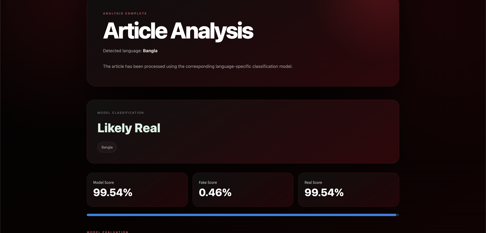

```markdown
# Fake News Detection — English + Bangla

A bilingual Machine Learning and Natural Language Processing project that classifies news articles as **Likely Real** or **Likely Fake**.

The system supports both **English** and **Bangla** news and automatically detects the language before selecting the appropriate model.

---

## Project Overview

- English and Bangla news classification
- Automatic language detection
- Separate models for both languages
- TF-IDF feature extraction
- Logistic Regression classification
- Streamlit web interface
- Home → Analysis → Result page flow

---

## Technology Stack

| Technology | Purpose |
|---|---|
| Python | Core programming language |
| Pandas | Data processing |
| Scikit-learn | Machine Learning |
| TF-IDF | NLP feature extraction |
| Logistic Regression | Classification |
| Joblib | Model saving/loading |
| Streamlit | Web interface |

---

## English Model Performance

| Metric | Score |
|---|---:|
| Accuracy | 99.18% |
| Precision | 98.81% |
| Recall | 99.69% |
| F1 Score | 99.25% |

---

## Bangla Model Performance

| Metric | Score |
|---|---:|
| Accuracy | 99.12% |
| Macro Precision | 95.51% |
| Macro Recall | 86.26% |
| Macro F1 Score | 90.33% |
| Real Recall | 99.83% |
| Fake Recall | 72.69% |

### Bangla Confusion Matrix

```text
[[ 189   71]
 [  17 9710]]
```

- 189 fake news articles were correctly identified as Fake
- 71 fake news articles were incorrectly predicted as Real
- 17 real news articles were incorrectly predicted as Fake
- 9,710 real news articles were correctly identified as Real

---

## Dataset

### English

Fake and Real News Dataset:

https://www.kaggle.com/datasets/clmentbisaillon/fake-and-real-news-dataset

Required files:

```text
data/
├── Fake.csv
└── True.csv
```

### Bangla

BanFakeNews:

https://www.kaggle.com/datasets/cryptexcode/banfakenews

Required files:

```text
data/
└── bangla/
    ├── Authentic-48K.csv
    └── Fake-1K.csv
```

---

## Project Structure

```text
fake-news-detection-ml-nlp/
├── app.py
├── train_model.py
├── train_bangla_model.py
├── requirements.txt
├── README.md
├── .gitignore
├── data/
│   └── README.md
└── models/
    ├── fake_news_model.pkl
    ├── tfidf_vectorizer.pkl
    ├── metrics.json
    ├── bangla_fake_news_model.pkl
    ├── bangla_tfidf_vectorizer.pkl
    ├── bangla_metrics.json
    └── bangla_threshold.json
```

---

## Installation

```bash
git clone YOUR_GITHUB_REPOSITORY_URL
cd fake-news-detection-ml-nlp
python3 -m venv .venv
source .venv/bin/activate
pip install -r requirements.txt
```

---

## Run

```bash
streamlit run app.py
```

---

## Important Note

This project is a Machine Learning text classification system.

`Likely Real` or `Likely Fake` does not independently prove whether a real-world news story is true or false.

---

## Model Limitations

This project has several limitations:

- Dataset bias may affect predictions
- The Bangla dataset is highly imbalanced
- New or unseen news-writing styles may reduce accuracy
- Model scores are not factual truth probabilities
- The system does not independently verify sources or claims
- The system does not analyze images or videos
- Real-world news may still be incorrectly classified

---

## Future Improvements

Possible future improvements include:

- BanglaBERT
- Multilingual BERT
- Transformer-based models
- News URL analysis
- Source credibility checking
- Explainable AI using SHAP or LIME
- Larger and more balanced Bangla datasets
- Live fact-checking integration
- Online Streamlit deployment

---

## Screenshots

Project screenshots can be added here:

## Screenshots

### Home Page


### Analysis Page


### Result Page


---

## Disclaimer

This project is developed for educational, learning and portfolio purposes.

The predictions **Likely Real** and **Likely Fake** are generated from patterns learned by Machine Learning models.

The application does not independently verify whether a real-world news story is factually true or false.

It should not be used as the sole source for determining the authenticity of a news article.

---

## Author

**Samiul Islam**
```